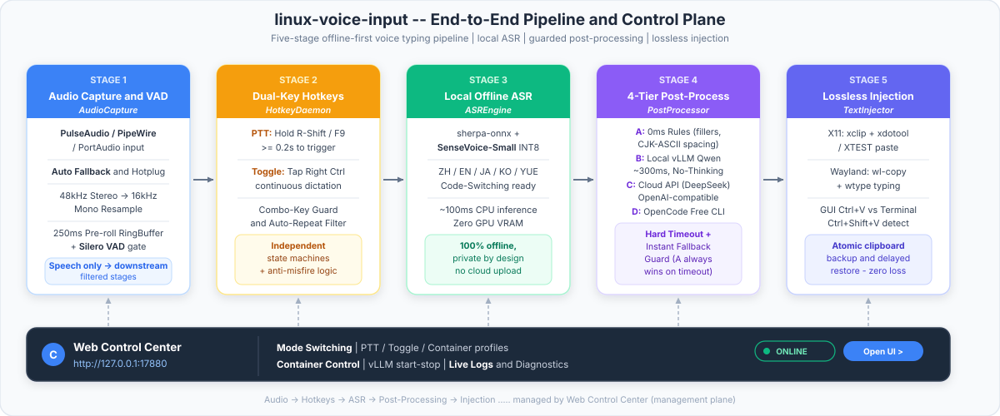
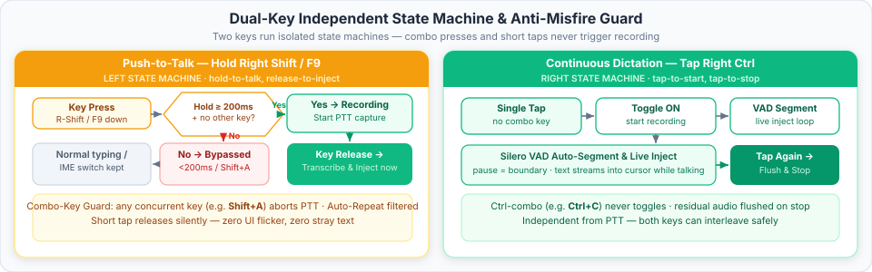
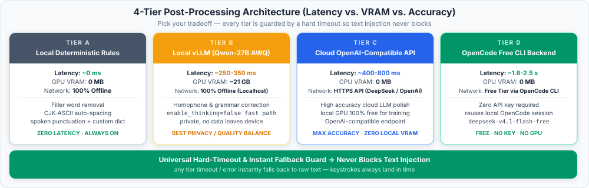
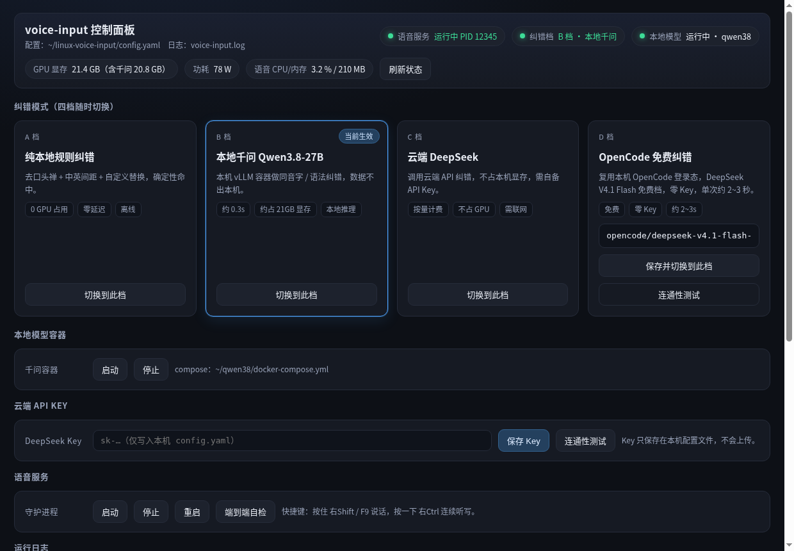

# linux-voice-input —— Linux 桌面低延迟离线语音输入

[简体中文](README.md) | [English](README_EN.md)

[](setup.sh)
[](voice_input/text_injector.py)
[](voice_input/asr_engine.py)
[](LICENSE)

> 面向 Linux 桌面的低延迟离线语音输入工具，针对中文与中英混输（Code-Switching）场景优化。
> 支持按住说话（PTT）与连续听写（Toggle）两种触发模式，经由剪贴板事务将识别文本注入当前焦点窗口，
> 并提供四档可插拔的后处理与同音字纠错链（故障时自动降级，永不阻塞上屏）与 Web 图形管控面板。

---

## 目录

- [特性一览](#特性一览)
- [开源生态调研：Linux 语音输入的现状与断层](#开源生态调研linux-语音输入的现状与断层)
- [竞品横向对比（9 维）](#竞品横向对比9-维)
- [核心技术优势](#核心技术优势)
- [系统架构](#系统架构)
- [双键独立状态机与防误触](#双键独立状态机与防误触)
- [四档后处理与 LLM 纠错体系](#四档后处理与-llm-纠错体系)
- [图形化管控面板](#图形化管控面板)
- [快速开始](#快速开始)
- [CLI 命令速查](#cli-命令速查)
- [配置参数](#配置参数)
- [故障排查](#故障排查)
- [目录结构](#目录结构)
- [开源协议与致谢](#开源协议与致谢)

---

## 特性一览

- **离线优先的中文识别引擎**：基于 `sherpa-onnx` 运行 `SenseVoice-Small (INT8)`，纯 CPU 推理，单句约 100ms，零 GPU 显存占用，原生支持标点恢复与逆文本规范化（ITN）。
- **四档可插拔后处理**：A（确定性规则，0ms）/ B（本地 OpenAI 兼容后端）/ C（云端 OpenAI 兼容 API）/ D（OpenCode CLI 免费档），任意后端超时或异常均在毫秒级静默回退，不阻塞上屏。
- **输入法框架无关**：不依赖 IBus 或 Fcitx5，可与系统现有输入法共存；支持 X11 与 Wayland。
- **窗口感知的剪贴板事务上屏**：自动区分终端模拟器与普通 GUI 应用，分别注入 `Ctrl+Shift+V` / `Ctrl+V`，注入后自动恢复用户原剪贴板内容。
- **双键独立交互**：PTT 与 Toggle 物理分离，内置蓄力阈值、组合键豁免、连发过滤、预卷缓冲与 VAD 自动断句。
- **Web 图形管控中心**：基于 Python 标准库实现，零第三方依赖；支持运行状态监控、四档热切换、容器启停、连通性诊断与日志查看。
- **免 Root 可迁移部署**：基于 `conda-forge` 工具链封装，通过 `./setup.sh` 一键完成环境、依赖与模型部署；配置文件中的相对路径均相对配置文件所在目录解析。

---

## 开源生态调研：Linux 语音输入的现状与断层

本节基于对 GitHub 上 8 个代表性开源项目的结构与实现方式调研，将当前 Linux 语音输入生态归纳为四个流派。
各项目星标数为调研时点的近似值，仅用于反映社区关注度量级，不作为质量评价依据。

### 流派一：早期极简命令行派

代表项目：`ideasman42/nerd-dictation`（约 1.9k Star）。

该流派出现较早，设计目标是提供最小可用的听写命令行。其典型特征是基于上一代轻量模型
（如 Vosk / Kaldi 系），无常驻守护进程与语音端点检测（VAD）断句逻辑，上屏多采用
`xdotool type` 逐字敲击。该方式对多字节字符（CJK）支持不佳，在中文场景下易出现乱码与丢字，
且中文词错误率较高，缺乏后处理纠错链。

### 流派二：Whisper 快捷键小工具与独立新锐项目

代表项目：`savbell/whisper-writer`（约 1.1k Star）、`VocaHQ/vocalinux`（约 945 Star）、
`pavlenkosa/wayvoice`（约 80 Star）。

该流派架构轻量，通常以全局快捷键触发录音，调用 Whisper 家族模型完成识别后上屏。
其共性约束来自对 Whisper 模型族的强绑定：

- 运行 `large-v3` 等大规模模型需要占用数 GB 显存，与本地训练或推理任务争抢资源；
- 运行小参数模型时中文识别准确率下降明显，且在静音段易产生幻觉重复（Hallucination）；
- 普遍缺乏针对中文同音字、中英混排的专用后处理纠错链。

### 流派三：重型多功能桌面客户端

代表项目：`mkiol/dsnote`（Speech Note，约 1.7k Star）、`zugaldia/speedofsound`（约 210 Star），
以及同类的 `Buzz` / `Vibe` 等转写应用。

该流派功能覆盖面广，部分项目支持上百种语言与翻译、字幕等附加能力，但设计重心多为
离线音频文件或笔记转写，而非“光标指哪打哪”的全局低延迟输入闭环。实现上多依赖重型 GUI
运行时（如 Qt 全家桶、JVM + GTK4），内存占用与启动开销相对较大，不适合常驻后台的输入场景。

### 流派四：特定生态强耦合方案

代表项目：`xifan2333/fcitx5-vinput`（约 574 Star）、`goodroot/hyprwhspr`（约 1.2k Star）。

该流派在目标生态内体验优秀，但可移植性受限于其耦合对象：

- `fcitx5-vinput` 作为 Fcitx5 输入法插件，中文输入体验成熟，但要求系统使用 Fcitx5 框架，
  Ubuntu 默认的 IBus 会话或纯英文环境无法直接使用；
- `hyprwhspr` 针对 Hyprland / wlroots 合成器深度调优，在其他桌面环境（GNOME / KDE / X11）
  上的复用成本较高，且一般不提供本地与云端多档 LLM 纠错及 Web 管控台。

总体而言，现有生态存在明显断层：**中文与中英混输质量、零显存离线推理、输入法无关的上屏事务、
多档 LLM 纠错与降级保障、图形化管控**这五方面很少在同一项目中同时得到满足，这正是本项目的设计切入点。

---

## 竞品横向对比（9 维）

下表横向对比本项目与上述 8 个代表性项目。星标为调研时点近似值；部分单元格基于各项目公开文档
与默认配置归纳，实际表现随模型选型与版本更新可能变化。

| 项目 | 形态与星标 | 核心 ASR 引擎 | 中文与中英混输 | 显存占用与延迟 | 输入法 / 桌面解耦度 | 触发交互模式 | 上屏机制与终端兼容 | LLM 纠错与降级 | Web 管控面板 |
|------|-----------|--------------|---------------|----------------|-------------------|-------------|-------------------|---------------|-------------|
| **linux-voice-input（本项目）** | 轻量常驻守护进程 + Web 面板 | `sherpa-onnx` + `SenseVoice-Small` (INT8) | 针对中文与中英术语混排优化，原生标点与 ITN，无静音幻觉 | **0 显存**（纯 CPU 4 线程，单句约 100ms） | 与 IBus / Fcitx5 完全解耦；支持 X11 与 Wayland | PTT（按住说话）+ Toggle（连续听写）双键独立，含组合键豁免 | 剪贴板事务：GUI 用 `Ctrl+V`，终端自动切 `Ctrl+Shift+V`，350ms 后恢复原剪贴板 | **A/B/C/D 四档可插拔**（含免费 CLI 档），硬超时毫秒级降级 | **有**（标准库实现，状态 / 切档 / 容器 / 诊断 / 日志） |
| [ideasman42/nerd-dictation](https://github.com/ideasman42/nerd-dictation)（~1.9k★） | 极简 Python CLI 脚本 | Vosk (Kaldi 系) | 中文词错误率高，无中英混排与标点优化 | CPU 运行，轻量但精度受限 | 与输入法无关，需外部绑定快捷键 | 外部脚本调用 `begin` / `end` | `xdotool type` / `wtype` 逐字敲击，中文易乱码或丢字 | 无（仅支持 Python 规则钩子） | 无 |
| [mkiol/dsnote](https://github.com/mkiol/dsnote)（~1.7k★） | C++/Qt 重型笔记转写套件 | Vosk / whisper.cpp / Faster-Whisper 等多引擎 | 依赖大模型，非中英混排特化 | 大模型占数 GB 显存；客户端常驻较重 | 独立应用，偏应用内笔记而非全局听写 | GUI 按钮或快捷键录音 | 落在应用内笔记区 / 手动复制粘贴，缺乏全局无损上屏闭环 | 无（仅含离线机器翻译） | 无（Qt 原生窗口） |
| [goodroot/hyprwhspr](https://github.com/goodroot/hyprwhspr)（~1.2k★） | Python systemd 服务 + OSD | Parakeet TDT / Whisper / Qwen3-ASR / 云端 | 选配 Qwen3-ASR 时中文较好，默认偏英文 | 依赖所选模型，GPU/CPU 可选 | 深度针对 Hyprland / wlroots 合成器调优 | 单快捷键触发（默认 `Super+Alt+D`） | `wtype` / `xdotool` + 剪贴板粘贴 | 弱（仅词表替换与提示词，无多档 LLM 纠错链） | 无（Waybar 状态集成） |
| [savbell/whisper-writer](https://github.com/savbell/whisper-writer)（~1.1k★） | Python + PyQt5 快捷键小工具 | `faster-whisper` / OpenAI API | Whisper 中文 CER 较高，静音段易幻觉重复 | 跑 `large-v3` 需数 GB 显存；小模型中文弱 | 与输入法无关，Wayland 下全局热键受限 | 单热键（支持 PTT / Toggle / VAD 四选一） | `pynput` / `pyautogui` 逐字符模拟输入，中文兼容性弱 | 无 | 无（仅 PyQt 设置窗） |
| [VocaHQ/vocalinux](https://github.com/VocaHQ/vocalinux)（~945★） | Python 桌面托盘应用 | `whisper.cpp` / Faster-Whisper / Vosk | 通用 Whisper 模型，无中文同音字特化 | 大模型占显存，小模型中文精度受限 | 独立托盘应用，跨发行版打包完善 | 按住 `Right Alt` 说话 | `xdotool` / IBus / `wtype` / `ydotool` / 剪贴板多路兼容 | 无 | 无（GTK 托盘设置） |
| [xifan2333/fcitx5-vinput](https://github.com/xifan2333/fcitx5-vinput)（~574★） | C++/Qt6 Fcitx5 输入法插件 | 本地 `sherpa-onnx` (SenseVoice) + 云端 ASR | 中文与混排体验优秀 | 本地 CPU 轻量 | **强绑定 Fcitx5**（Ubuntu 默认 IBus 用户无法使用） | `Alt_R` 单键点按 / 长按双模 + 命令模式 | Fcitx5 原生 `commit_text`（仅限 Fcitx5 生态内） | 有（支持场景化 LLM 改写与润色） | 无（Qt6 配置界面） |
| [zugaldia/speedofsound](https://github.com/zugaldia/speedofsound)（~210★） | Kotlin + GTK4/libadwaita 应用 | `sherpa-onnx` (Whisper / Parakeet / Canary) | 内置多语言 Whisper，无 SenseVoice 中文特化 | JVM + GTK4 内存与冷启动开销较大 | 基于 XDG Desktop Portal，X11/Wayland 通用 | 应用按钮 / 全局快捷键 / 托盘 | XDG RemoteDesktop Portal 模拟输入 | 有（支持本地或云端 LLM 文本抛光） | 无（GTK4 桌面界面） |
| [pavlenkosa/wayvoice](https://github.com/pavlenkosa/wayvoice)（~80★） | Python + GTK/libadwaita 轻量工具 | Faster-Whisper / `whisper.cpp` / Parakeet | 通用 Whisper 模型，缺乏中文混排后处理 | 取决于 Whisper 模型规模 | 仅面向 GNOME Wayland（Alpha 阶段） | 快捷键触发单次转写 | Wayland 剪贴板投递 + 可选 `ydotool` 粘贴 | 无（仅静态词表替换） | 无 |

---

## 核心技术优势

### 1. 专为中文与中英术语混排优化的零显存引擎

本项目采用 `sherpa-onnx` 运行时加载 `SenseVoice-Small (INT8)` 模型。默认 4 CPU 线程下，
单句推理延迟约 100ms，且全程零 GPU 显存占用，不会与本地深度学习训练或推理任务争抢资源。
模型原生输出带标点的文本并支持逆文本规范化（ITN，如数字与符号归一），中英术语混排无需外挂后处理。
与 Whisper 家族相比，该路线从根本上规避了静音段幻觉重复问题，更适合桌面输入这种短句、高频、
启停随意的场景。

### 2. 四档可插拔后处理与极速同音字纠错（硬超时无感降级）

后处理采用 A + B + C + D 四级架构，详见后文“四档后处理”小节：

- A 档为确定性规则层（去口头禅、中英空格、自定义口述词替换），延迟为 0ms，永远先生效；
- B 档面向本地 OpenAI 兼容推理后端（示例配置为 vLLM，亦可替换为 Ollama / llama.cpp 等），
  通过 `enable_thinking=false` 等参数要求模型直接输出纠错结果，局域延迟可控制在数百毫秒量级；
- C 档面向云端 OpenAI 兼容 API，零本地显存，适用于 GPU 被训练任务占满的场景；
- D 档经由 OpenCode CLI 复用本地登录态调用免费模型档，无需管理 API Key。

所有 LLM 档位均内置长度、符号与连接护栏与硬超时约束，任何网络波动、服务停止或输出异常
均在毫秒级静默回退至 A 档规则结果。**纠错链的任何故障都不会阻塞文字上屏**，这是贯穿全流水线的设计不变量。

### 3. 免换输入法框架的 X11 / Wayland 无损剪贴板事务

本项目不要求替换系统现有输入法（IBus 与 Fcitx5 均可共存），上屏经由剪贴板事务完成：
备份用户当前剪贴板、写入识别文本、向焦点窗口注入粘贴快捷键、延迟约 350ms 后自动恢复原剪贴板内容。
注入前通过窗口类别识别区分终端模拟器与普通 GUI 应用，对前者注入 `Ctrl+Shift+V`，
对后者注入 `Ctrl+V`。该机制彻底避免了 `xdotool type` 逐字敲击在中文与多字节字符场景下的乱码与丢字问题。

### 4. 双键独立状态机与生产级防误触工程细节

“按住说话（PTT）”与“连续听写（Toggle）”使用两组物理独立的按键与状态机，避免单键复用带来的歧义。
工程细节包括：约 200ms 蓄力阈值（过滤输入法中英切换式的短按）、组合键自动豁免
（如 `Right Shift + 字母` 输入大写、`Right Ctrl + C` 复制等均不触发录音）、X11 自动连发过滤、
约 250ms 环形预卷缓冲（防止吞首字）、Silero VAD 尾句自动 Flush（连续模式不断尾）。
两组按键、阈值与 VAD 参数均可在配置文件中调整。

### 5. 零外部依赖的 Web 图形管控中心与免 Root 一键迁移

管控面板后端仅使用 Python 标准库（`http.server`），无新增第三方依赖，支持实时资源监控、
四档热切换、本地推理容器启停、云端连通性诊断与日志查看。部署侧基于 `conda-forge` 工具链封装，
在无 `sudo` 权限的机器上亦可通过 `./setup.sh` 完成环境、依赖与模型的一键部署；
系统级工具缺失时采用 best-effort 策略（有权限则自动安装，无权限则提示手动安装，不阻塞识别本身）。
所有相对路径均相对配置文件所在目录解析，整目录迁移后无需改写绝对路径。

---

## 系统架构

语音链路为“采集 → 识别 → 后处理 → 注入”的串行流水线（`main.py:VoiceInputApp._process_and_inject`，
经 `_pipeline_lock` 串行化，避免并发注入互相打断），管控面板作为独立进程提供运维入口。

<p align="center"></p>

| 模块 | 文件 | 职责 |
|------|------|------|
| 热键守护 | `voice_input/hotkey_daemon.py` | 监听 PTT / Toggle 按键，输出录音起止事件 |
| 音频采集 | `voice_input/audio_capture.py` | 麦克风采集、重采样至 16kHz、预卷缓冲、VAD 断句、USB 热插拔重连 |
| 识别引擎 | `voice_input/asr_engine.py` | sherpa-onnx + SenseVoice 推理、预热与 ITN |
| 后处理 | `voice_input/post_processor.py` | A 档规则 + B/C/D 档 LLM 纠错与降级 |
| 文本注入 | `voice_input/text_injector.py` | 剪贴板事务与 X11 / Wayland 双栈粘贴 |
| 管控面板 | `voice_input/control_center.py` + `dashboard.html` | Web 后端与前端，档位切换、容器与服务管理 |

---

## 双键独立状态机与防误触

| 模式 | 操作 | 行为 |
|------|------|------|
| 按住说话（PTT） | 按住 PTT 键（默认 `Right Shift` 或 `F9`） | 按住超过 `hold_threshold_sec`（默认 0.20s）且期间无其他按键则开始录音并播放 `start.wav`；松开即识别上屏并播放 `stop.wav` |
| 连续听写（Toggle） | 按一下 Toggle 键（默认 `Right Ctrl`） | 开启连续听写，Silero VAD 按 `min_silence_duration`（默认 0.6s 静音）自动断句、逐句上屏；再按一下结束，尾部未断句语音（不短于 0.25s）自动 flush 识别 |

<p align="center"></p>

防误触设计（`voice_input/hotkey_daemon.py`）：

- 短按 PTT 键（如输入法中英切换）因未达到蓄力阈值而不触发；
- 按住期间出现其他按键（如 `Right Shift + 字母` 输入大写）则整次按住被豁免；
- Toggle 键与其他键组合（如 `Right Ctrl + C`）被判定为普通组合键而不触发；
- X11 自动连发（auto-repeat）事件被过滤，不会重复启停录音；
- 两组按键均可在 `config.yaml` 的 `hotkey` 段自定义，`ptt_key` 支持逗号分隔的多个键。

---

## 四档后处理与 LLM 纠错体系

所有档位均先经过 A 档规则层；B / C / D 档在此基础上叠加 LLM 纠错。
任何超时或异常均静默回退至规则结果。

<p align="center"></p>

| 档位 | 后端形态 | 延迟与资源 | 适用场景 |
|------|---------|-----------|---------|
| A：纯本地规则（0ms） | 正则与字符串替换，零延迟 | 0ms，零显存 | 默认兜底；任何 LLM 失败时的回退目标 |
| B：本地推理后端 | 本地 OpenAI 兼容接口（示例为 vLLM，亦可配置 Ollama / llama.cpp 等），`enable_thinking=false` 直接输出 | 数百毫秒量级，资源占用取决于所部署模型 | 本机有 GPU 且数据不出本机 |
| C：云端 API | 云端 OpenAI 兼容接口（如 DeepSeek `deepseek-chat`） | 零本地显存，按量计费，延迟取决于网络 | 本地 GPU 被训练任务占满时 |
| D：OpenCode CLI 免费档 | 经由本机 OpenCode 登录态调用 CLI（示例模型 `opencode/deepseek-v4.1-flash-free`） | 无需 API Key，单次约 2–3s | 不希望管理 Key 的免费纠错场景 |

A 档规则细节（`voice_input/post_processor.py`）：

- **去口头禅**：移除句首或句中孤立的语气词与填充词（如“嗯”“呃”“那个”），内置护栏避免误删实义词；
- **中英自动空格**：在汉字与 ASCII 字母或数字交界处补空格（`你好world` → `你好 world`）；
- **自定义口述词替换**：长词优先匹配，如默认将“新的一行”映射为换行符，可在 `custom_replacements` 中增删。

LLM 档位护栏：请求带硬超时（本地档默认 1.5s，云端档默认 8.0s），响应需通过长度、符号与
连接性校验，校验失败或超时一律丢弃并采用 A 档结果上屏。

---

## 图形化管控面板

<p align="center"></p>

```bash
./run.sh dashboard        # 后台启动，端口取 config.yaml 中 control_center.port（默认 17880）
./run.sh dashboard 17881  # 指定端口启动
./run.sh dashboard-stop   # 停止面板
```

浏览器访问 `http://127.0.0.1:<port>/`（仅监听本机回环）。亦可在应用菜单中启动
“语音输入控制面板”（`voice-input-dashboard.desktop`，使用系统自带 `audio-input-microphone`
图标，其 `Exec` 经 `%k` 定位自身目录后调用 `run.sh`，不包含硬编码绝对路径）。

| 面板区域 | 能力 |
|----------|------|
| 顶部状态条 | 语音服务运行状态、当前纠错档、本地模型容器状态、GPU 显存与功耗、手动刷新 |
| 四档模式卡 | A 纯本地规则 / B 本地推理 / C 云端 API / D OpenCode 免费，一键切换并自动重启守护进程 |
| 本地模型行 | 启动或停止本地推理容器（`docker compose -f <compose> up -d` / `stop`），显示 compose 路径；文件不存在时显示“未部署本地模型” |
| 云端行 | 填写并保存云端 API Key（仅写入本机 `config.yaml`）、一键连通性测试（`GET /api/deepseek_test`） |
| 服务行 | 启动、停止、重启语音守护进程，端到端自检（返回输出尾部 40 行） |
| 日志框 | 语音服务日志尾部，支持自动与手动刷新（`GET /api/logs?lines=60`） |
| 危险区 | “停止全部服务”“关闭电脑”，需双重确认（两次对话框，第二次要求 `confirm:"YES"`）；关机操作不可撤销 |

后端 API（`voice_input/control_center.py`，标准库 `http.server` 实现，零新增依赖）：

| 方法 | 路径 | 说明 |
|------|------|------|
| GET | `/api/status` | 语音进程、档位、容器状态与资源占用（均为 best-effort，缺失返回 `null`） |
| POST | `/api/mode` | `{"mode":"off"\|"local_qwen"\|"deepseek"\|"opencode"}`，改写 `post_processor` 并重启守护进程 |
| POST | `/api/qwen` | `{"action":"start"\|"stop"}`，启停本地推理容器 |
| POST | `/api/voice` | `{"action":"start"\|"stop"\|"restart"\|"test"}` |
| POST | `/api/deepseek_key` | `{"api_key":"…"}`，写入 `llm_modes.deepseek.api_key` |
| GET | `/api/deepseek_test` | 使用当前 Key 请求 `{api_base}/models`（10s 超时） |
| POST | `/api/opencode_test` | 单次 CLI 纠错探测，返回耗时与输出（90s 超时） |
| GET | `/api/logs?lines=60` | 语音服务日志尾部 |
| POST | `/api/power` | `{"action":"stop_all"\|"shutdown","confirm":"YES"}`，必须双确认 |

---

## 快速开始

```bash
git clone https://github.com/<your-username>/linux-voice-input.git
cd linux-voice-input
./setup.sh          # 创建 conda 环境、安装依赖、下载 SenseVoice 与 VAD 模型并自检
./run.sh start      # 启动后台语音守护进程
./run.sh dashboard  # 启动图形化管控面板 (http://127.0.0.1:17880/)
```

说明：

1. `setup.sh` 自动定位或安装 conda，创建 `voice-input` 环境（Python 3.10），安装 Python 依赖、
   下载缺失模型，最后执行 `./run.sh test` 自检。系统工具（`xclip`/`xdotool`/`wl-clipboard`）
   按 best-effort 安装：具备 `sudo` 权限时自动安装，缺失权限时跳过并提示手动安装，不阻塞识别本身。
2. 如需经代理下载模型与依赖，请先设置 `export http_proxy=http://127.0.0.1:7897 https_proxy=http://127.0.0.1:7897`。
3. 首次使用前复制一份配置：`cp config.example.yaml config.yaml`（参数含义见“配置参数”一节）。

---

## CLI 命令速查

```bash
./run.sh start            # 后台启动守护进程（PID: /tmp/voice-input.pid，日志: voice-input.log）
./run.sh stop             # 停止后台守护进程
./run.sh restart          # 重启后台守护进程
./run.sh status           # 查看运行状态与最近 15 行日志
./run.sh fg               # 前台运行（实时日志，Ctrl+C 退出）
./run.sh test             # 端到端自检（环境 / 麦克风 / ASR / 后处理 / LLM / 剪贴板 / 录音）
./run.sh dashboard [port] # 后台启动图形化管理面板（PID: /tmp/voice-input-dashboard.pid，日志: dashboard.log）
./run.sh dashboard-stop   # 停止图形化管理面板
./run.sh mode <档>        # 切换纠错档：off（纯本地规则）| local_qwen（本地推理）| deepseek（云端）| opencode（免费）
./run.sh install-desktop  # 安装应用菜单快捷方式（复制 voice-input-dashboard.desktop 到 ~/.local/share/applications/）
```

直接调试入口（使用环境中的 Python）：

```bash
# 录音 3 秒 -> 识别 -> 纠错 -> 注入当前焦点窗口
"$(conda info --base)/envs/voice-input/bin/python" main.py --once 3

# 指定配置文件启动 / 运行自检
"$(conda info --base)/envs/voice-input/bin/python" main.py --config config.yaml
"$(conda info --base)/envs/voice-input/bin/python" main.py --config config.yaml --test-pipeline
```

亦可通过环境变量 `VOICE_INPUT_PYTHON` 指定解释器，跳过 conda 环境查找。

---

## 配置参数

仓库仅追踪 `config.example.yaml`，不追踪 `config.yaml`（后者已被 `.gitignore` 忽略）。

- `config.example.yaml`：带完整注释的模板，含各档位预置与默认值，可安全提交；
- `config.yaml`：本地真实配置，由 `cp config.example.yaml config.yaml` 创建后修改
  （填写云端 API Key、调整麦克风匹配子串、热键、端口等）；
- 该分离机制用于避免 API Key 与 per-machine 配置被意外提交至公开仓库；
  面板写入 Key 时亦仅写入本机 `config.yaml`；
- 程序启动以 `config.yaml` 为准，缺失项自动以 `main.py:DEFAULT_CONFIG` 补齐，
  模板新增字段不会导致旧配置崩溃。

| 段 | 关键项 | 说明 |
|----|--------|------|
| `audio` | `preferred_device_substring` | 优先匹配的 PulseAudio 输入源子串（大小写不敏感），为空则使用系统默认麦克风；填错亦自动回退。示例值如 `"USB"` 或某款耳机麦克风型号子串 |
| | `pre_roll_ms` | 录音预卷（默认 250ms，防止吞首字） |
| | `vad_model_path` / `vad_threshold` / `min_silence_duration` | Silero VAD 模型路径与断句参数；模型缺失时自动退化为 RMS 能量检测 |
| `hotkey` | `ptt_key` / `toggle_key` / `hold_threshold_sec` | 默认 `shift_r,f9` / `ctrl_r` / 0.20s |
| `asr` | `model_dir` / `num_threads` / `use_itn` / `language` / `provider` | SenseVoice 模型目录 / 推理线程数 / 逆文本规范化 / `auto` / `cpu` 或 `cuda` |
| `post_processor` | `clean_fillers` / `auto_space_cjk_ascii` / `custom_replacements` | 去口头禅 / 中英混排空格 / 口述词替换 |
| | `enable_llm` / `api_base` / `api_key` / `model` / `timeout` / `disable_thinking` | 本地或云端 OpenAI 兼容接口配置（模板默认指向本地 `http://127.0.0.1:8000/v1`，硬超时 1.5s；可替换为 Ollama / llama.cpp 等任意兼容后端） |
| | `llm_backend` / `opencode_model` / `opencode_timeout` | `openai` 或 `opencode_cli`（D 档经由本机 `opencode run` 子进程） |
| `injector` | `restore_clipboard` / `restore_delay_sec` | 注入后恢复原剪贴板 / 恢复延迟（默认 0.35s） |
| `feedback` | `enable_sound` / `start_wav` / `stop_wav` / `enable_notification` | 提示音与桌面通知（默认仅声音，避免弹窗抢焦点） |
| `llm_modes` | `local_qwen` / `deepseek` / `opencode` | 三档模板；A 档对应 `post_processor.enable_llm=false` |
| `control_center` | `port` / `qwen_compose_file` / `proxy` | 面板端口（默认 17880，仅 127.0.0.1）/ 本地推理 compose 文件 / 云端代理 |

所有相对路径（模型、提示音）均相对配置文件所在目录解析，整目录迁移后可直接使用。

---

## 故障排查

1. **Wayland 下按键注入受限**：优先使用 `wtype` / `ydotool`，缺失时回退至双栈兼容方案；
   `ydotool` 需后台服务与 `uinput` 权限，请按发行版文档配置。
2. **本地推理档不可用**：若本地模型容器未启动或显存不足，请求在硬超时后自动降级为 A 档上屏，
   日志中出现纠错失败回退提示属预期行为，而非崩溃。
3. **云端档需联网与有效 Key**：Key 为空时面板拒绝切换；访问境外 API 时请在
   `control_center.proxy` 或环境变量 `http_proxy` / `https_proxy` 中配置代理。
4. **OpenCode 档单次约 2–3s**：经由 `opencode run` 子进程，延迟受登录态与网络影响；
   CLI 异常或超时自动降级。免费额度仅支持本机 CLI 路径，直接 HTTP 调用推理接口会被拒绝，
   因此本项目未提供 HTTP 对接（见 `voice_input/post_processor.py:polish_opencode_cli`）。
5. **终端粘贴键**：守护进程自动区分终端与普通窗口；若终端模拟器使用自定义粘贴键，
   请提交 issue 并附 `xprop WM_CLASS` 输出。
6. **剪贴板工具缺失**：X11 需要 `xclip` / `xsel` 与 `xdotool`，Wayland 需要 `wl-clipboard`；
   `main.py` 启动时自动将 conda 环境 `bin/` 前置入 `PATH`，仍失败请安装对应系统包。
7. **`DISPLAY` 探测**：无 `DISPLAY` 的后台启动按 `/tmp/.X11-unix/X*` 自动探测；
   纯 Wayland 会话返回 `None` 并走 Wayland 路径。通过 SSH 启动前请先确认 `echo $DISPLAY`。
8. **USB 麦克风热插拔**：采集线程持续运行并在断开后自动重连；`preferred_device_substring`
   留空即始终使用系统默认麦克风。
9. **提示音缺失**：确认 `paplay` 可用、`feedback.enable_sound` 为 `true` 且 `assets/*.wav` 存在。

仍未解决时，请依次执行并在 issue 中附输出：`./run.sh status` → `./run.sh test` →
`tail -n 50 voice-input.log` / `tail -n 50 dashboard.log`。

---

## 目录结构

- `main.py` — 主控程序（守护进程 / 自检 / `--once` 单次模式）
- `config.example.yaml` — 配置模板（仓库追踪）
- `config.yaml` — 本地真实配置（git 忽略，需自行复制创建）
- `run.sh` — 管理脚本（start / stop / status / fg / test / dashboard / mode / install-desktop）
- `setup.sh` — 一键部署（conda 环境 / 依赖 / 模型 / 自检，免 sudo 可用）
- `voice-input-dashboard.desktop` — 应用菜单快捷方式
- `README.md` / `README_EN.md` — 中英文档
- `voice_input/` — 功能模块
  - `audio_capture.py` — 麦克风采集与 VAD（默认麦回退 / 热插拔重连）
  - `asr_engine.py` — SenseVoice 识别（INT8 / 预热 / ITN）
  - `post_processor.py` — 两级后处理（规则层 + B/C/D 路 LLM 纠错）
  - `text_injector.py` — 剪贴板注入（X11 + Wayland 双栈，终端自动判别）
  - `hotkey_daemon.py` — 双键独立双模（PTT + Toggle，组合键豁免）
  - `control_center.py` — 面板后端（标准库 `http.server`，零新增依赖）
  - `dashboard.html` — 面板前端
- `models/` — SenseVoice 与 Silero VAD 模型（由 `setup.sh` 自动下载）
- `assets/` — 架构与流程图表、提示音（`architecture.svg`、`hotkey_flow.svg`、`tier_comparison.svg`、`dashboard_preview.png`、`start.wav`、`stop.wav`）

---

## 开源协议与致谢

- 本项目采用 **MIT License**，详见 [LICENSE](LICENSE)。
- 致谢：
  - [Sherpa-ONNX](https://github.com/k2-fsa/sherpa-onnx) —— 跨平台本地语音推理引擎；
  - [SenseVoice](https://github.com/FunAudioLLM/SenseVoice) —— 多语言 ASR 模型（中 / 英 / 粤 / 日 / 韩）；
  - [Silero VAD](https://github.com/snakers4/silero-vad) —— 轻量语音端点检测，用于连续听写自动断句。
